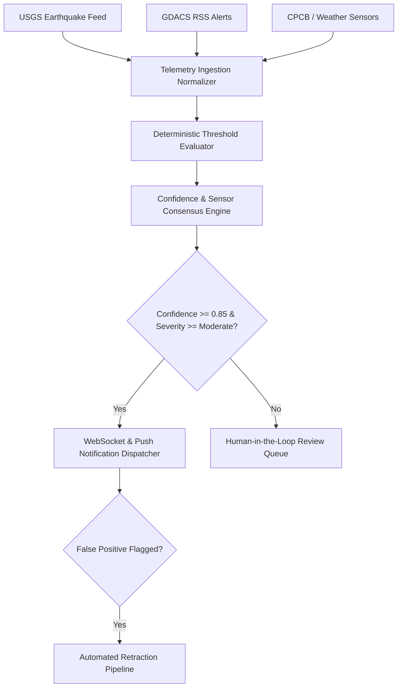

# Suraksha Setu Deterministic Risk Engine Specification

Suraksha Setu utilizes a deterministic multi-hazard assessment engine combined with threshold gating to evaluate raw incoming telemetry from USGS, GDACS, and CPCB.

## 1. Hazard Scoring Thresholds

- **Earthquake:** Magnitude $\ge 6.0$ OR Depth $\le 20\text{ km}$ triggers Immediate Advisory.
- **Tsunami Warning:** Oceanic epicenter $\text{Magnitude} \ge 7.0$ triggers Red Zone evacuation.
- **Cyclone:** Sustained wind speed $\ge 65\text{ knots}$ (Category 1+).
- **Urban Flood:** Precipitation rate $\ge 65\text{ mm/hr}$ sustained over 3 hours.
